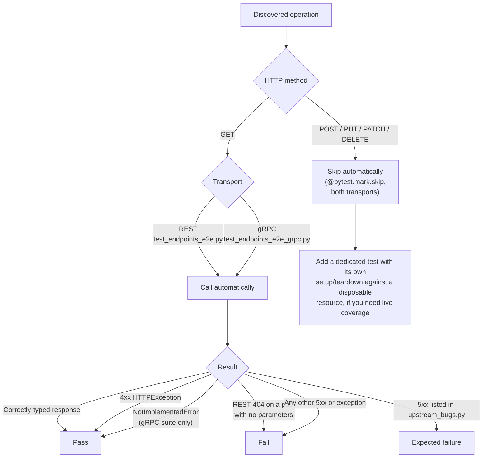

<!-- HAND-WRITTEN: not modified by [`uv run poe generate`](../../pyproject.toml). Edit directly. -->

# End-to-End Tests (Real API, Opt-In)

Runs against the real Kentik API. Not part of [`uv run poe test`](../../pyproject.toml) or
[`uv run poe all`](../../pyproject.toml). See the layered strategy in
[../README.md](../README.md) for how this layer fits with the other
four mocked ones.

> [!WARNING]
> This suite calls a real Kentik account. Read this whole file
> before you add a test here.

## Files

| File | Role |
| --- | --- |
| `conftest.py` | The `real_client` (REST) and `grpc_real_client` (gRPC) fixtures. Both delegate all credential loading to `KentikAPI()` (a project-root `.env` file, or `KENTIK_EMAIL`/`KENTIK_API_TOKEN`). Either fixture skips the whole suite when no credentials are configured. |
| `test_endpoints_e2e.py` | The end-to-end operation tests, REST transport. |
| `test_endpoints_e2e_grpc.py` | The same coverage over the gRPC transport. Additionally treats `NotImplementedError` as a passing outcome (see AGENTS.md's "gRPC transport is fully implemented" section). A wrapper raises `NotImplementedError` when the service's proto companions fail to import, or when no RPC shares the operation's HTTP rule. Today every operation has a gRPC translation. |
| `test_alert_list_e2e.py` | A live check of `alerting.list`, a read-only POST that the auto-discovered suite skips. |
| `test_v5_query_e2e.py` | Live checks of the read-only V5 query POSTs (`client.v5.top_x_data`, `query_url`, and `top_x_chart`, which is an expected failure while the endpoint does not answer). Also runs `top_x_data` on a gRPC client. |
| `test_v5_batch_e2e.py` | **Writes to the account.** Upserts one disposable flow tag, then deletes it in `finally`. Marker `e2e_mutating`, so neither `uv run poe test-e2e` nor `uv run poe test-e2e-grpc` runs it. Run it by hand: `uv run pytest -m e2e_mutating --run-live-e2e tests/e2e/test_v5_batch_e2e.py`. |
| `test_crud_e2e.py` | **Writes to the account.** Create, read, update, and delete round trips on disposable objects (label, site, site market, AS group, flow tag, saved filter, custom application), on both transports. Marker `e2e_mutating`. Run it with `uv run poe test-e2e-mutating`. |
| `ledger.py` | Records each object that a mutating test creates in `.created_objects.jsonl` (not committed). Run it with `uv run poe e2e-cleanup` to list leftovers. |
| `test_upstream_workarounds_e2e.py` | **Writes to the account.** One strict-xfail canary per upstream bug that the SDK works around. Each sends the documented request. A canary that passes means upstream fixed the bug; see "Upstream workarounds" in AGENTS.md. Marker `e2e_mutating`. |
| `upstream_bugs.py` | The reads that fail because of an upstream bug (5xx), with the bug each one hits. Both endpoint suites mark them as strict xfails. |

Endpoint discovery comes from
[`tests/_discovery.py`](../_discovery.py) (`discover_endpoint_cases()`), which builds on
the same `discover_cases()`/`WrapperCase` discovery [`tests/generated/`](../generated/README.md) uses, not a hand-written list. The two endpoint suites above
share the identical discovered cases and GET-vs-mutating split.

## How read and mutating operations differ



Only GET (read-only) operations run automatically, with only their required
arguments. Placeholder values for optional filters are not valid input, and
the mocked suites already cover every option. A read call passes when it
returns a correctly-typed response, or when it raises a 4xx `HTTPException`,
for example 404 for a sample ID. The test cannot control what data exists in
the real account, so a 4xx is a valid answer.

One 4xx fails the REST test: a 404 on a path with no parameters. Such a call
has no ID to miss, so the 404 means the server does not serve the route. This
happens when upstream publishes a schema version before it deploys it.

A 5xx fails the test, because it is a server failure. When the failure is an
upstream bug, add the operation to `upstream_bugs.py` with the bug it hits.
The test then becomes a strict xfail. When upstream fixes the bug, it fails
as `XPASS(strict)`, and you remove the entry.

Create, Update, and Delete operations are deliberately not
auto-called. `test_mutating_endpoint_excluded_from_e2e` and its gRPC
twin `test_mutating_endpoint_excluded_from_e2e_grpc` each carry a
`@pytest.mark.skip` marker on purpose, because a mutating call
against a real account is hard to reverse. To add live coverage for
one mutating endpoint, write a dedicated test with its own setup and
teardown against a disposable resource. Do not wire it into the
auto-discovered path.

## Run

```bash
uv run poe test-e2e       # REST transport
uv run poe test-e2e-grpc  # gRPC transport
```

Neither suite runs by accident. `addopts` in `pyproject.toml`
excludes both by default. A bare `pytest -m e2e` (or `-m e2e_grpc`)
still skips every test, because the `--run-live-e2e` flag is also
needed. The two poe tasks pass that flag for you.

## Mutating tests and the ledger

The mutating tests change only objects that they create. Each object gets a
name that starts with `sdk-e2e-test-`. The test records the object in the
ledger before it does anything else with it. An update or a delete goes
through `ledger.owned()`, which refuses an ID that the ledger does not hold.

After each test, the `ledger` fixture deletes what the test left. If a delete
fails, the object stays in the ledger and the fixture fails the test.

```bash
uv run poe test-e2e-mutating     # run the mutating tests
uv run poe e2e-cleanup           # list the objects in the ledger
uv run poe e2e-cleanup --delete  # delete them
```

Before `--delete` removes an object, it reads the object again. It deletes the
object only when its name still starts with the test prefix.

A strict `xfail` marks each call that failed live for every payload tried.
The reason on the marker names the cause. When the cause is fixed, the test
fails as `XPASS(strict)`, and you can remove the marker.

## Credentials

Set `KENTIK_EMAIL` and `KENTIK_API_TOKEN` in a project-root `.env`
file. Never hardcode credentials in test code. Never read or print
`.env` contents.
