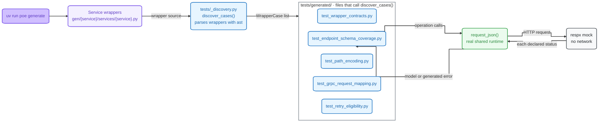

<!-- HAND-WRITTEN: not modified by [`uv run poe generate`](../../pyproject.toml). Edit directly. -->

# Generated Wrapper Tests

This layer is mocked and uses no network. See the layered strategy in
[../README.md](../README.md) for how this layer fits with the other
four.

## Files

| File | Covers |
| --- | --- |
| [`test_wrapper_contracts.py`](test_wrapper_contracts.py) | Contract tests for every generated snake_case service wrapper: argument forwarding, transport branching, and discovery rules. |
| [`test_endpoint_schema_coverage.py`](test_endpoint_schema_coverage.py) | Every discovered operation, run against every response status code that the OpenAPI schema declares for it. |
| [`test_schema_operations.py`](test_schema_operations.py) | The generated REST modules match the operations in [`schema_operations.json`](../../schema_operations.json). Needs no schema checkout. |
| [`test_grpc_request_mapping.py`](test_grpc_request_mapping.py) | Each gRPC wrapper call reaches the right RPC with every argument set. |
| [`test_grpc_stub_wiring.py`](test_grpc_stub_wiring.py) | Every mounted wrapper builds a live gRPC stub. |
| [`test_model_wire_names.py`](test_model_wire_names.py) | Every model field sends the same wire name that it reads. |
| [`test_proto_body_keys.py`](test_proto_body_keys.py) | The REST updates under the upstream body-key workaround send the proto name. Other bodies keep the camelCase name. |
| [`test_path_encoding.py`](test_path_encoding.py) | The SDK encodes every REST path parameter into its own segment. |
| [`test_retry_eligibility.py`](test_retry_eligibility.py) | Which operations a future retry policy can replay, derived from each operation's HTTP verb. |
| [`test_alert_acknowledgement.py`](test_alert_acknowledgement.py) | An alert that carries an acknowledgement parses (audit finding B2). |

The contract, coverage, path encoding, gRPC request mapping, and retry eligibility files import shared discovery and sample-building helpers from
[`tests/_discovery.py`](../_discovery.py), so they stay in sync with
the e2e suite.



## Run

```bash
uv run poe test-generated
# or
uv run pytest tests/generated/
```

## Add a test here

- [`test_wrapper_contracts.py`](test_wrapper_contracts.py) auto-discovers wrapper modules. It
  parses `src/kentik_api/gen/*/services/*.py`. Add logic here only
  when the wrapper contract itself changes globally. You usually do
  not add a per-service test by hand.
- [`test_endpoint_schema_coverage.py`](test_endpoint_schema_coverage.py) drives the real
  [`request_json`](../../src/kentik_api/core/README.md) runtime and
  the real generated error classes through `respx`-mocked HTTP. Add
  logic here only when the status or error coverage strategy itself
  changes. A new service, operation, or status code needs no manual
  update: the next [`uv run poe generate`](../../pyproject.toml) picks it up automatically.

> [!NOTE]
> The test coverage requirement in [AGENTS.md](../../AGENTS.md)
> (every endpoint, every option, every declared status code) maps to
> [`test_endpoint_schema_coverage.py`](test_endpoint_schema_coverage.py).
