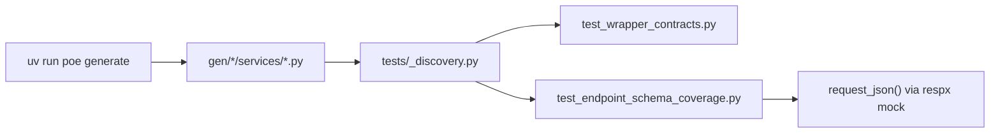

<!-- HAND-WRITTEN: not modified by [`uv run poe generate`](../../pyproject.toml). Edit directly. -->

# Generated Wrapper Tests

Mocked, no network. See the layered strategy in
[../README.md](../README.md) for how this layer fits with the other
four.

## Files

| File | Covers |
| --- | --- |
| `test_wrapper_contracts.py` | Contract tests for every generated snake_case service wrapper: argument forwarding, transport branching, and discovery rules. |
| `test_endpoint_schema_coverage.py` | Every discovered operation, run against every response status code the OpenAPI schema declares for it. |
| `test_schema_operations.py` | The generated REST modules match the operations in `schema_operations.json`. Needs no schema checkout. |
| `test_grpc_request_mapping.py` | Each gRPC wrapper call reaches the right RPC with every argument set. |
| `test_grpc_stub_wiring.py` | Every mounted wrapper builds a live gRPC stub. |
| `test_model_wire_names.py` | Every model field sends the name it was read under. |
| `test_proto_body_keys.py` | The REST updates under the upstream body-key workaround send the proto name. Other bodies keep the camelCase name. |
| `test_path_encoding.py` | Every REST path parameter is encoded into its own segment. |
| `test_retry_eligibility.py` | Which operations a future retry policy can replay, derived from each operation's HTTP verb. |
| `test_alert_acknowledgement.py` | An alert that carries an acknowledgement parses (audit finding B2). |

The contract, coverage, path encoding, gRPC request mapping, and retry eligibility files import shared discovery and sample-building helpers from
[`tests/_discovery.py`](../_discovery.py), so they stay in sync with
the e2e suite automatically.



## Run

```bash
uv run poe test-generated
# or
uv run pytest tests/generated/
```

## Add a test here

- **`test_wrapper_contracts.py`** auto-discovers wrapper modules by
  parsing `src/kentik_api/gen/*/services/*.py`. Add logic here only
  when the wrapper contract itself changes globally. You usually do
  not add a per-service test by hand.
- **`test_endpoint_schema_coverage.py`** drives the real
  [`request_json`](../../src/kentik_api/core/README.md) runtime and
  the real generated error classes through `respx`-mocked HTTP. Add
  logic here only when the status or error coverage strategy itself
  changes. A new service, operation, or status code needs no manual
  update: the next [`uv run poe generate`](../../pyproject.toml) picks it up automatically.

> [!NOTE]
> `test_endpoint_schema_coverage.py` is what AGENTS.md's test
> coverage requirement (every endpoint, every option, every declared
> status code) maps to concretely.
